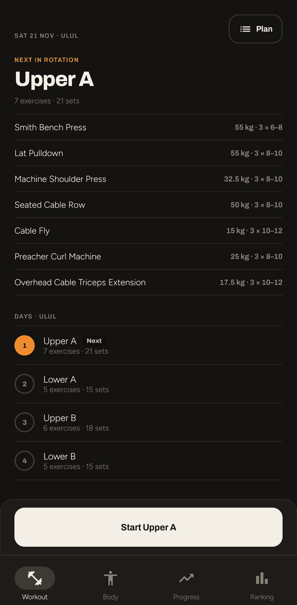
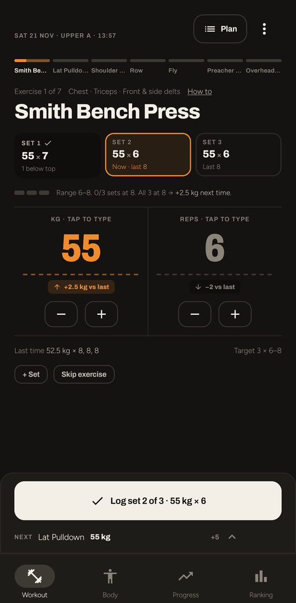
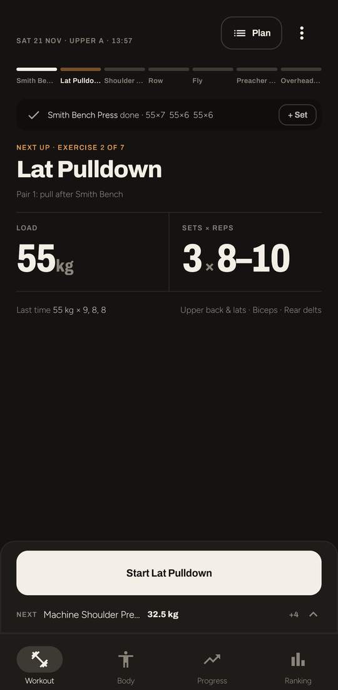
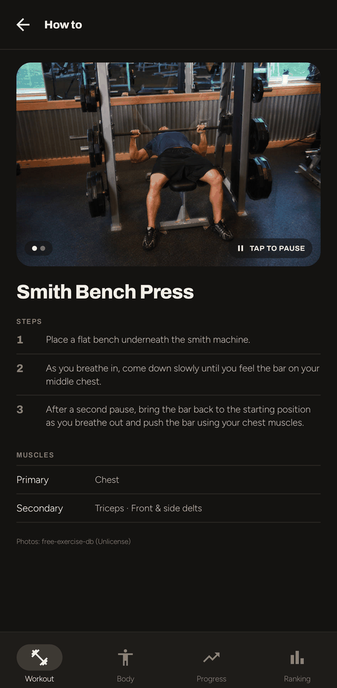
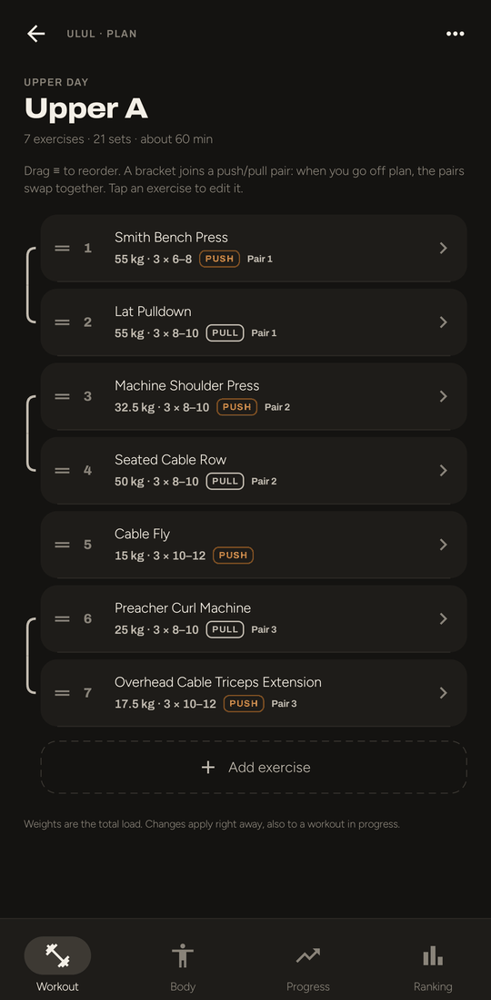
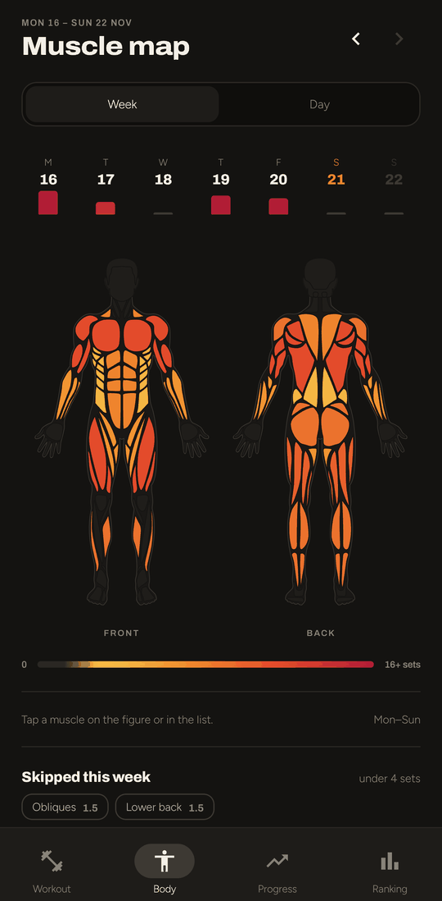
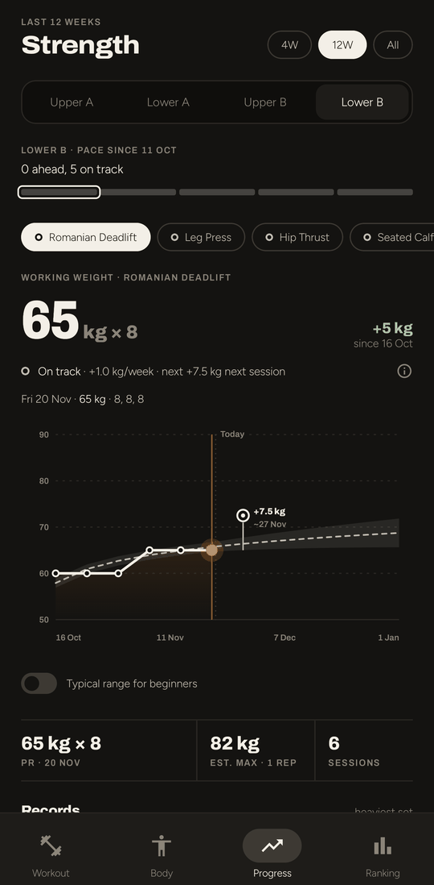
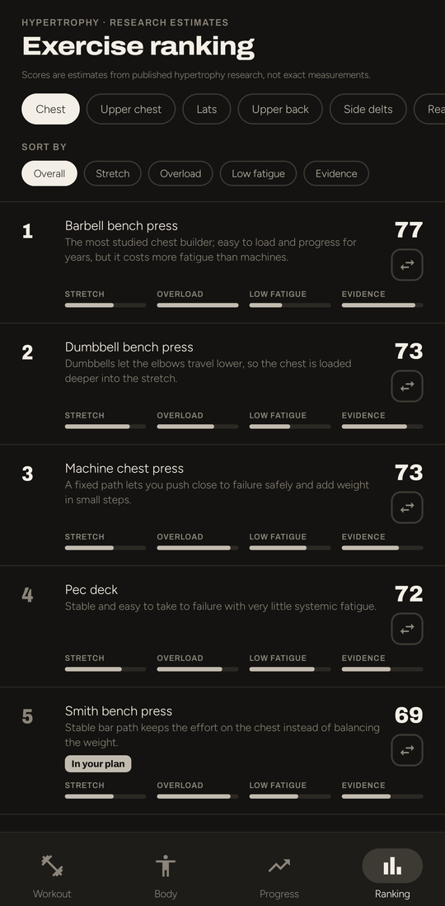

# Overload

A focused, offline gym tracker for Android that tells you what to lift today, built around double progression.

<p>
  
  
  
  
</p>
<p>
  
  
  
  
</p>

<sub>Screenshots use fictional demo data.</sub>

## Features

- **Double progression.** Each exercise has a rep range. Once every set reaches the top of the range, the next workout raises the load by a set percentage, rounded to the machine's or plates' load step (at least one step), and you start again from the bottom of the range.
- **Shared loads.** An exercise that shows up on several days of a split uses one working load, so progress on one day carries over to the others.
- **Push/pull pairs.** Pair a push and a pull exercise in the plan. If a machine is taken, start another exercise and the pairs reorder around it.
- **Focus workout screen.** It shows one exercise at a time with a ladder of sets, large kg and reps controls, and a "vs last" cue that compares each set with your last session. A raised load is highlighted.
- **How-to pages.** Each exercise has step-by-step instructions, the muscles it works and an animated photo demo. You can also add your own video link.
- **Home-screen widget.** Start the next workout, then log sets with − / + and *Log set* without opening the app.
- **Body heat map.** See sets per muscle for each week or day on a front and back body figure, along with the muscles you skipped.
- **Strength progress.** Track working weight and estimated one-rep max per lift, with records and an expected-pace curve that shows whether you are ahead, on track or behind.
- **Exercise ranking.** Exercises for each muscle are scored on stretch, overload, fatigue and evidence. The scores are estimates from published hypertrophy research.
- **Private by design.** The app works fully offline, with no accounts, ads, analytics or tracking. Back up or restore all your data as one JSON file.

A new install starts empty. Choose a split template (ULUL, PPL, Full body or Custom) in **Plan**, then add exercises to each day from the bundled exercise library.

## Requirements

- Android 8.0 (API 26) or newer. The app targets API 36.

## Building

You need JDK 17 or newer and the Android SDK, either from Android Studio or the command-line tools with `ANDROID_HOME` or `local.properties` (`sdk.dir=...`) set. The Gradle daemon asks for JDK 21 and Gradle provisions it automatically if it is missing.

```sh
./gradlew assembleDebug
adb install -r app/build/outputs/apk/debug/app-debug.apk
```

The debug build installs as `com.apollo.overload.debug`, next to a release build. `./install.sh [device-serial]` builds the debug APK, installs it and launches it in one step.

Run the unit tests with:

```sh
./gradlew :app:testDebugUnitTest
```

### Release signing

Release builds are signed only when a `keystore.properties` file exists in the project root. This file is not in the repository. It looks like this:

```properties
storeFile=release.keystore
storePassword=...
keyAlias=...
keyPassword=...
```

`storeFile` is resolved relative to the project root. Without the file, `./gradlew assembleRelease` produces an unsigned APK.

## Project structure

```
app/src/main/
  assets/            exercises.json (exercise library), howto.json + howto/ (demo photos),
                     ranking.json (exercise scores), body.json (body figure paths)
  java/com/apollo/overload/
    data/            Room entities, DAO and database, repository, JSON backup, workout actions
    domain/          Pure logic: progression, session order, push/pull pairs, vs-last, expected pace
    ui/              Jetpack Compose screens: workout, plan, body, progress, ranking, settings (backup)
    widget/          Glance home-screen widget
  res/font/          Archivo and Figtree
app/src/test/        Unit tests for the domain logic and screen data
app/schemas/         Room schema history (for migrations)
tools/               Python scripts that rebuild the exercise and how-to assets from free-exercise-db
```

## Credits

- Body figure paths from [react-native-body-highlighter](https://github.com/HichamELBSI/react-native-body-highlighter) by Hicham El Abbassi (MIT).
- Exercise data and photos from [free-exercise-db](https://github.com/yuhonas/free-exercise-db) (Unlicense).
- Fonts: [Archivo](https://github.com/Omnibus-Type/Archivo) and [Figtree](https://github.com/erikdkennedy/figtree) (SIL Open Font License 1.1).
- Built with Kotlin, Jetpack Compose, Room and Glance (Apache 2.0).

See [THIRD_PARTY_NOTICES.md](THIRD_PARTY_NOTICES.md) for the full license texts.

## License

[MIT](LICENSE) © 2026 Juliusz Kosela
